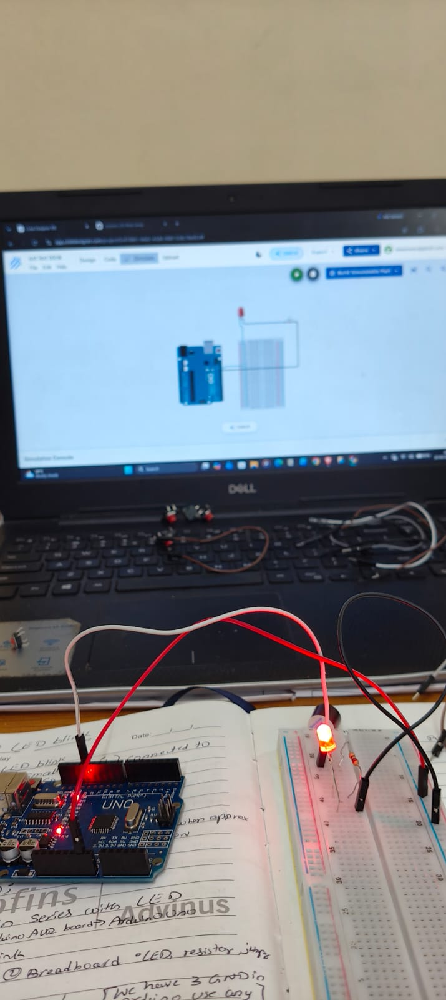
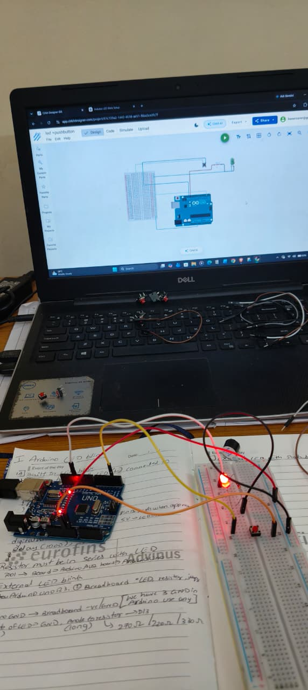
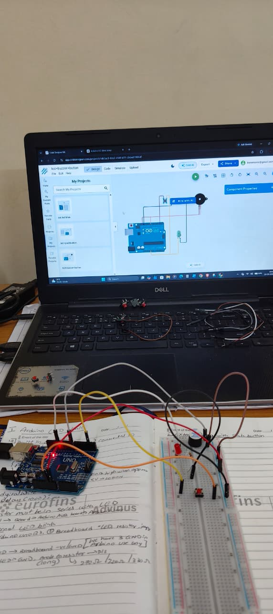

# LED Basics — Arduino Experiments

This folder contains three beginner-friendly Arduino projects exploring digital outputs, push-button inputs, and buzzer control.

## Project Demonstration

Watch the LED experiments in action on LinkedIn:

[View LED Experiments Video on LinkedIn](https://lnkd.in/p/gASenYEs)

## 1. External LED Blink

An external LED is connected to an Arduino digital output pin and programmed to turn ON and OFF repeatedly.

**Source code:** [`01_External_LED_Blink.ino`](./01_External_LED_Blink.ino)

## 2. LED Control Using a Push Button

A push button is used as an input to control an LED, introducing basic digital input and output operations.

**Source code:** [`02_LED_Push_Button.ino`](./02_LED_Push_Button.ino)

## 3. Push Button, LED and Buzzer

This experiment combines a push button, an LED, and a buzzer to demonstrate input-controlled visual and audible outputs.

**Source code:** [`03_LED_Push_Button_Buzzer.ino`](./03_LED_Push_Button_Buzzer.ino)

## Concepts Learned

- Arduino digital input and output
- LED interfacing and control
- Push-button operation
- Buzzer interfacing
- Basic embedded-system programming

## Hardware Used

- Arduino board
- LEDs and suitable current-limiting resistors
- Push button
- Buzzer
- Breadboard and jumper wires

