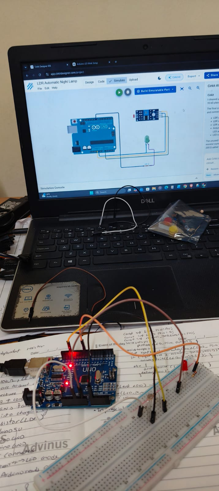
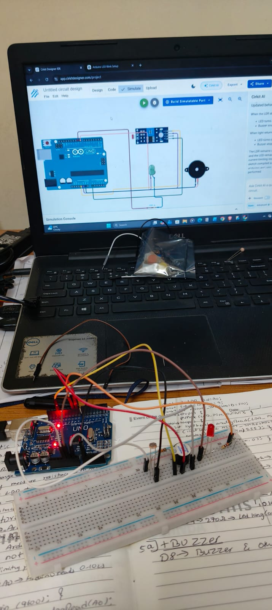

# LDR Automatic Lighting — Arduino Experiments

## Overview
This folder contains two Arduino experiments using a Light Dependent Resistor (LDR) to respond to changes in ambient light.

## 1. LDR Automatic Night Lamp

An LDR senses the surrounding light level. The Arduino uses the sensor reading to control an LED automatically, demonstrating a simple automatic lighting system.

**Source code:** [`01_LDR_Automatic_Night_Lamp.ino`](./01_LDR_Automatic_Night_Lamp.ino)

## 2. LDR Night Lamp with Buzzer

This experiment extends the LDR-based night lamp by adding a buzzer to provide an audible output under the programmed conditions.

**Source code:** [`02_LDR_Night_Lamp_Buzzer.ino`](./02_LDR_Night_Lamp_Buzzer.ino)

## Hardware Used
- Arduino board
- LDR sensor or LDR module
- LED and current-limiting resistor
- Buzzer (second experiment)
- Breadboard and jumper wires

## Concepts Learned
- Light sensing using an LDR
- Analog sensor readings
- Conditional control using sensor values
- Interfacing LEDs and buzzers
- Basic automation with Arduino

