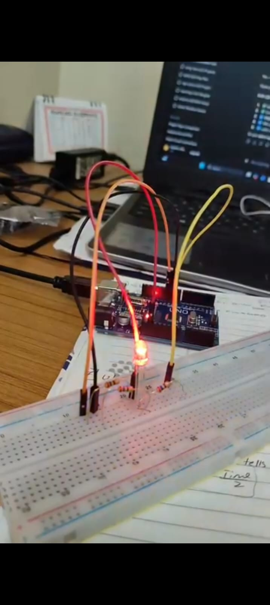
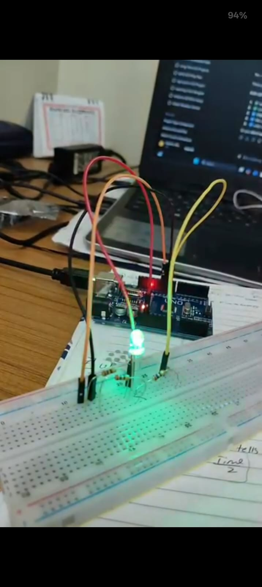
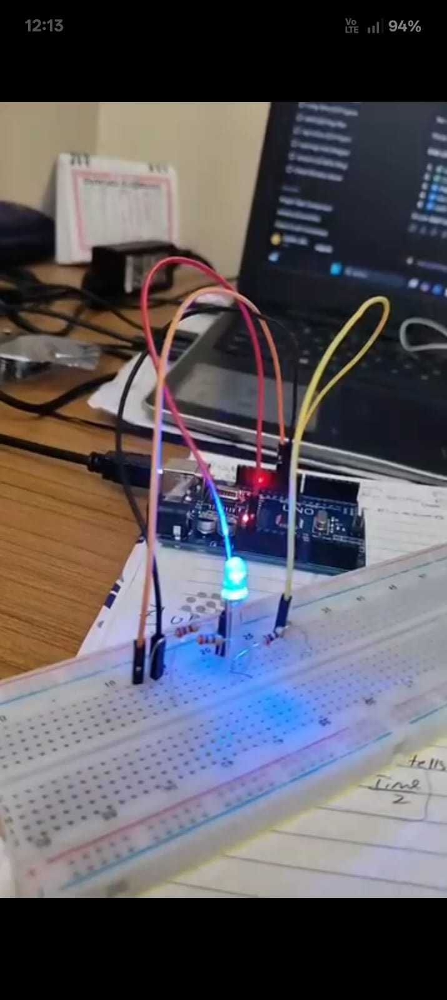
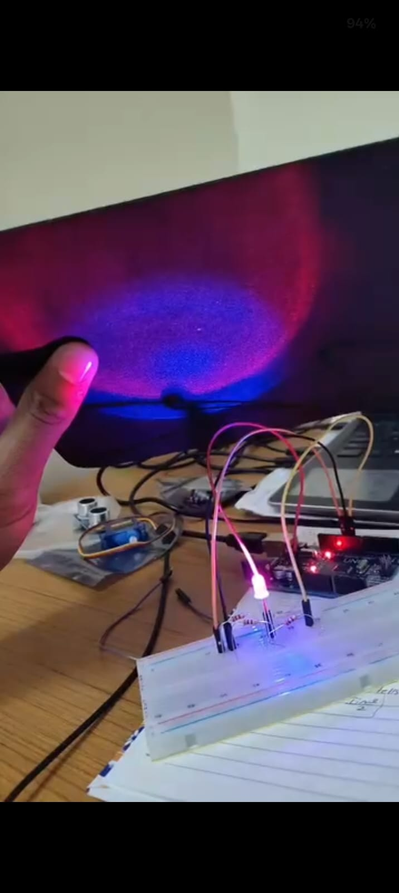

# RGB LED Experiments

## Overview
This folder contains six Arduino experiments using an RGB LED to understand color generation, brightness control, and potentiometer-based input.

## Experiments

| No. | Experiment | Description |
|---|---|---|
| 1 | RGB Color Sequence | Displays red, green, and blue in sequence. |
| 2 | Red LED Fading | Gradually increases and decreases red LED brightness. |
| 3 | RGB Color Mixing | Combines RGB channels to produce different colors. |
| 4 | Cyan, White, and Off | Demonstrates cyan, white, and LED-off states. |
| 5 | Potentiometer Color Selection | Uses a potentiometer to select red, green, or blue. |
| 6 | Potentiometer Brightness Control | Adjusts red LED brightness using a potentiometer. |

## Components Used
- Arduino Uno
- RGB LED
- 3 current-limiting resistors for the RGB LED
- Potentiometer
- Breadboard and jumper wires

## Pin Connections
- Red LED: Digital pin 9
- Green LED: Digital pin 10
- Blue LED: Digital pin 11
- Potentiometer output: Analog pin A0 (Experiments 5 and 6)

## Project Photos

### RGB Color Sequence

**Red LED**

**Green LED**

**Blue LED**

### RGB Color Mixing

**Purple — Red + Blue**

## Code Files
