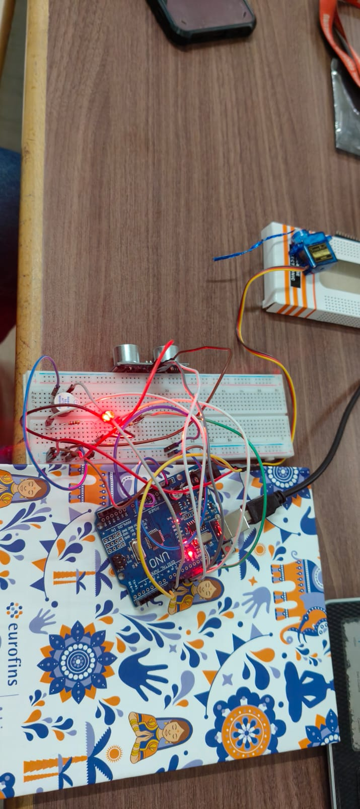

# Automatic Parking Gate Using Arduino

## Overview

An Arduino-based automatic parking gate system that detects an approaching vehicle or object using an ultrasonic sensor and controls a servo motor to open and close the gate automatically.

This project demonstrates how sensors and actuators can be combined to build a simple automated parking access system.

## Features

- Automatic object detection using an ultrasonic sensor
- Servo motor-based gate opening and closing
- RGB LED status indication
- Buzzer alert when an object is detected
- Real-time distance monitoring through the Serial Monitor

## Components Used

- Arduino Uno
- HC-SR04 Ultrasonic Sensor
- Servo Motor
- RGB LED
- Buzzer
- Breadboard
- Jumper wires

## Pin Connections

| Component | Arduino Pin |
|---|---|
| Ultrasonic Sensor — Trig | 9 |
| Ultrasonic Sensor — Echo | 10 |
| Servo Motor Signal | 5 |
| RGB LED Red | 11 |
| RGB LED Green | 12 |
| RGB LED Blue | 13 |
| Buzzer | 6 |

## Working Principle

1. The ultrasonic sensor measures the distance of an object in front of it.
2. When an object is detected within the set threshold of 15 cm, the servo motor rotates to 90°, opening the gate.
3. The buzzer activates and the RGB LED provides a visual indication.
4. When the detected distance exceeds 15 cm, the servo returns to 0°, closing the gate, and the buzzer turns off.
5. The measured distance is displayed in the Serial Monitor at 9600 baud.

## Control Logic

- **Distance ≤ 15 cm:** Gate opens and buzzer turns on.
- **Distance > 15 cm:** Gate closes and buzzer turns off.

## Project Photo

## Source Code

[View Automatic Parking Gate Arduino Code](./Automatic_Parking_Gate.ino)

## Learning Outcomes

- Interfacing an ultrasonic sensor with Arduino
- Controlling a servo motor using programmed logic
- Working with RGB LEDs and buzzers
- Using conditional statements for automation
- Integrating multiple electronic components into a single system
- Understanding the basics of automated parking systems

## Project Status

Completed as a hands-on Arduino electronics project.

## Future Improvements

- Add an LCD or OLED display to show distance and gate status.
- Implement vehicle counting functionality.
- Improve detection reliability and gate timing.
- Add an RFID-based access system for authorized vehicles.

## Platform and Tools

- **Microcontroller:** Arduino Uno
- **Programming Environment:** Arduino IDE
- **Language:** C/C++ (Arduino)
- **Application Area:** Embedded Systems and Automation
